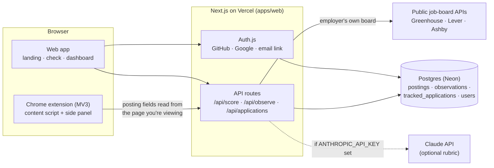

# Real Role

Real Role gives a job posting a **Freshness Score** from 0 to 100: an estimate of how likely it is to be a real, active opening. Every score shows the signals behind it, so you decide for yourself. It also tracks the roles you apply to and reminds you when to follow up.

- **Website:** https://real-role.vercel.app (check a posting, dashboard, how scoring works)
- **Chrome extension:** a score badge on the posting you're viewing, with the full breakdown in Chrome's side panel. See [Install the extension](#install-the-extension).
- **Demo video:** recorded from an automated run of the real product. See [Demo video](#demo-video).

> **Status (2026-10-16).** The site's production deployment lags `main`; the owner redeploys it (see [`docs/deployment-runbook.md`](docs/deployment-runbook.md) once it lands). The add-on tools in PR #24 (shortlist, insights, coach sharing and others) are under review and **not live yet**. The extension isn't on the Chrome Web Store yet.

## How the score works

Five signals, each worth a share of 100 points. Every point traces to a row you can see in the UI.

| Signal                  | What it looks at                                                                  |
| ----------------------- | --------------------------------------------------------------------------------- |
| Posting age             | When the role was posted (from the page or the employer's job board)              |
| Repost history          | How long Real Role users have been seeing the same role, and how often            |
| Careers page            | Whether the role is listed on the employer's own Greenhouse, Lever or Ashby board |
| Description detail      | Pay range, named team or manager, concrete duties, plus an optional AI rubric     |
| Company hiring activity | How many roles the employer lists, and how recently they changed                  |

When a signal can't be checked it isn't counted against the posting: the other signals are scaled up and the **confidence** goes down. Real Role shows signals, not verdicts, and never calls a posting fake. Details and worked examples: [`docs/scoring.md`](docs/scoring.md).

## Architecture



| Path               | Package                | What it is                                                                       |
| ------------------ | ---------------------- | -------------------------------------------------------------------------------- |
| `packages/shared`  | `@real-role/shared`    | The contract: types, zod schemas, API routes, test ids (tagged `v0.1-contract`)  |
| `packages/scoring` | `@real-role/scoring`   | Pure scoring engine, no I/O                                                      |
| `packages/parsers` | `@real-role/parsers`   | Reads postings from the page: per-board parsers plus a JSON-LD fallback          |
| `packages/ats`     | `@real-role/ats`       | Greenhouse, Lever and Ashby adapters behind one interface                        |
| `apps/web`         | `@real-role/web`       | Next.js (App Router) + Tailwind: site, API routes, Drizzle schema and migrations |
| `apps/extension`   | `@real-role/extension` | WXT Chrome extension: badge, side panel, Save & track                            |
| `demo/`            | `@real-role/demo`      | Fictional fixture pages and the demo-video pipeline                              |

Design rules that shape the code: the extension reads only the page you have open; the server never crawls job boards or automates logged-in sessions; cross-checks use only official public ATS APIs; we store a posting fingerprint, extracted fields and anonymous sightings plus your own tracked items, never description text, résumés or browsing history. See [`SECURITY.md`](SECURITY.md) and the [privacy policy](https://real-role.vercel.app/privacy).

## Quick start (local)

Needs Node 22 (`.nvmrc`) and pnpm 10.

```bash
corepack enable              # or: npm i -g pnpm
pnpm install
pnpm check                   # format, agent-docs check, lint, typecheck, unit tests
```

Run the web app against an in-process Postgres (no accounts or cloud database needed):

```bash
cp .env.example apps/web/.env.local
# in apps/web/.env.local set:  DATABASE_URL=pglite:./.pglite-dev   and   AUTH_SECRET=<npx auth secret>
# db:migrate doesn't read .env.local, so pass the URL inline:
DATABASE_URL=pglite:./.pglite-dev pnpm --filter @real-role/web db:migrate
pnpm --filter @real-role/web dev        # http://localhost:3000 (Next.js reads .env.local)
```

Step-by-step setup, sign-in providers, the extension and production: [`docs/getting-started.md`](docs/getting-started.md). Something not working: [`docs/troubleshooting.md`](docs/troubleshooting.md).

## Commands

| Command                                         | What it does                                                                                    |
| ----------------------------------------------- | ----------------------------------------------------------------------------------------------- |
| `pnpm check`                                    | Everything CI's first job runs: format check, agent-docs check, lint, typecheck, tests          |
| `pnpm test` / `pnpm lint` / `pnpm typecheck`    | One task across all packages (Turborepo)                                                        |
| `pnpm --filter @real-role/<pkg> test`           | One package, e.g. `@real-role/scoring`                                                          |
| `pnpm --filter @real-role/web dev`              | Web app at http://localhost:3000                                                                |
| `pnpm --filter @real-role/web build`            | Production build of the web app                                                                 |
| `pnpm --filter @real-role/web db:migrate`       | Apply Drizzle migrations to `DATABASE_URL`                                                      |
| `pnpm --filter @real-role/extension build`      | Production extension → `apps/extension/.output/chrome-mv3` (API: real-role.vercel.app)          |
| `pnpm --filter @real-role/extension build:demo` | Local/demo build (API `http://localhost:3100`, also runs on `127.0.0.1` fixtures)               |
| `pnpm --filter @real-role/extension zip`        | Chrome Web Store zip → `apps/extension/.output/real-role-extension-<version>-chrome.zip`        |
| `pnpm --filter @real-role/extension e2e`        | End-to-end tests: local web app on PGlite + fictional fixtures + the real extension in Chromium |
| `pnpm demo:video`                               | Record and assemble the demo video (`demo/output/real-role-demo.mp4`)                           |

## Install the extension

Until the Chrome Web Store listing is live:

1. Download `real-role-extension-<version>-chrome.zip` from the [latest GitHub release](https://github.com/jkaral/real-role/releases/latest) (**pending**: the first release is published when the owner pushes a `v*` tag), or build it yourself with `pnpm --filter @real-role/extension zip`.
2. Unzip it into a folder you'll keep, open `chrome://extensions`, turn on **Developer mode** and click **Load unpacked**.
3. Pin Real Role, open a job posting and click the score badge.

The extension talks only to `https://real-role.vercel.app`. A new extension build can depend on new API routes, so **deploy the backend first, then ship the extension** ([`docs/getting-started.md`](docs/getting-started.md#production)).

## Demo video

A 60–90 second narrated video recorded from an automated run of the real extension and web app on fictional postings. The run is also a test: it fails if the scores or UI states are wrong (latest verified: 98 high, 19 low, 61 medium on the three fictional fixtures; these are demo fixtures, not customer outcomes).

- **Regenerate it:** Actions → **CI** → **Run workflow** with **demo** checked. The `real-role-demo` artifact holds the MP4 (artifacts expire after 90 days).
- **Permanent link:** pending. It will be attached to the first GitHub release.

## Local and cloud workspaces

Two AI coding agents build this repo, coordinated through pull requests and the append-only [`docs/HANDOFF.md`](docs/HANDOFF.md):

- **Codex** works in a local workspace on the owner's machine.
- **Claude Code** works in cloud sessions that clone this repo from GitHub. A cloud session sees only what's pushed, has no Vercel credentials, and its network policy may block some hosts (e.g. text-to-speech). Anything needing the owner's accounts is listed as an owner action in `HANDOFF.md`.

Ownership, branch naming and the contract process: [`CLAUDE.md`](CLAUDE.md) (identical to [`AGENTS.md`](AGENTS.md)); the shared brief: [`docs/PROJECT_BRIEF.md`](docs/PROJECT_BRIEF.md); task board: [`docs/WORKSTREAMS.md`](docs/WORKSTREAMS.md).

## Contributing

Branches are `claude/<topic>` or `codex/<topic>`; `main` accepts PRs only, with green CI. Use fictional companies and `.example` domains in fixtures, tests and demos. User-facing wording stays neutral: never "fake" or "scam" about a posting or employer.

## License

MIT
